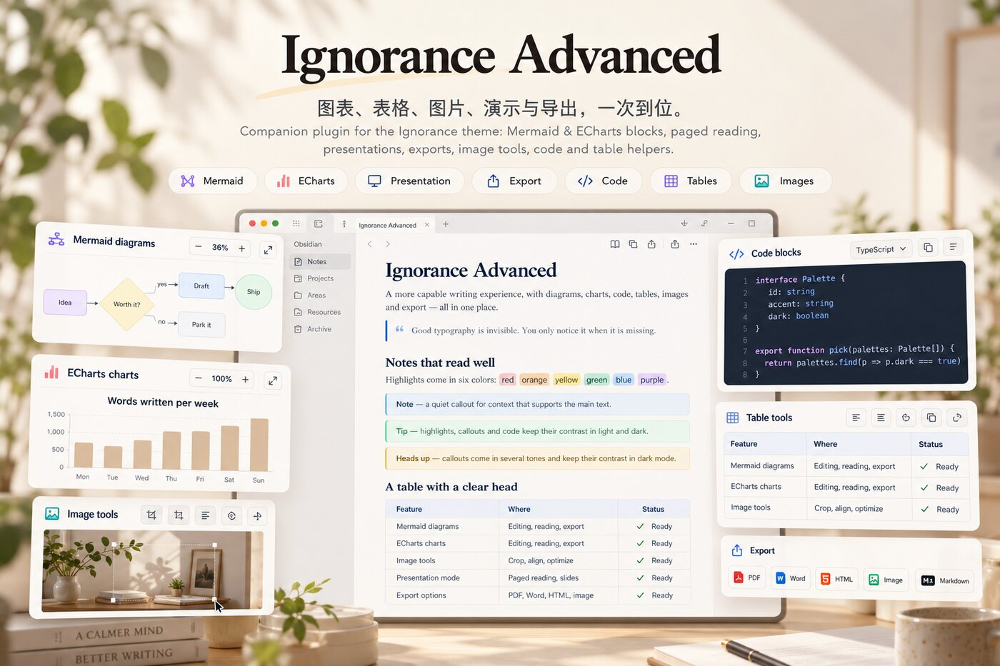
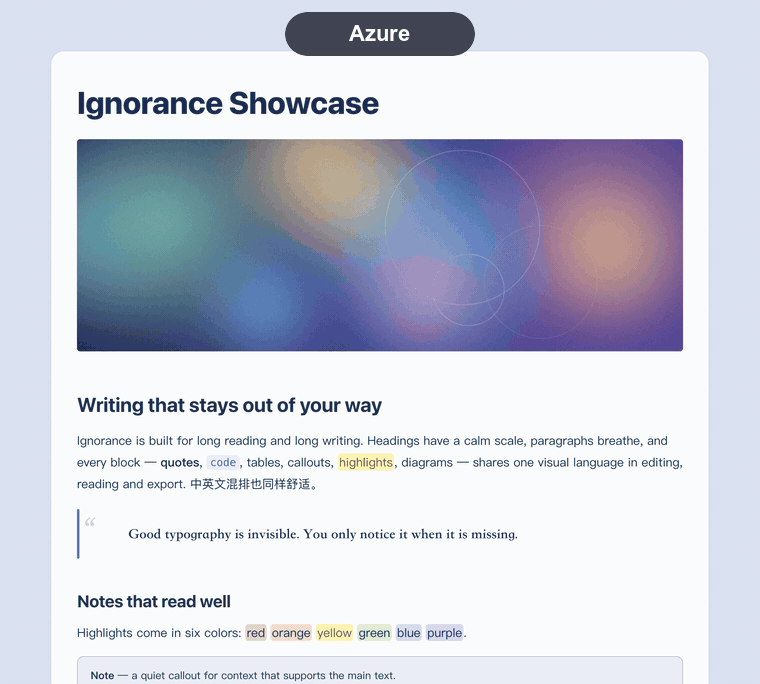
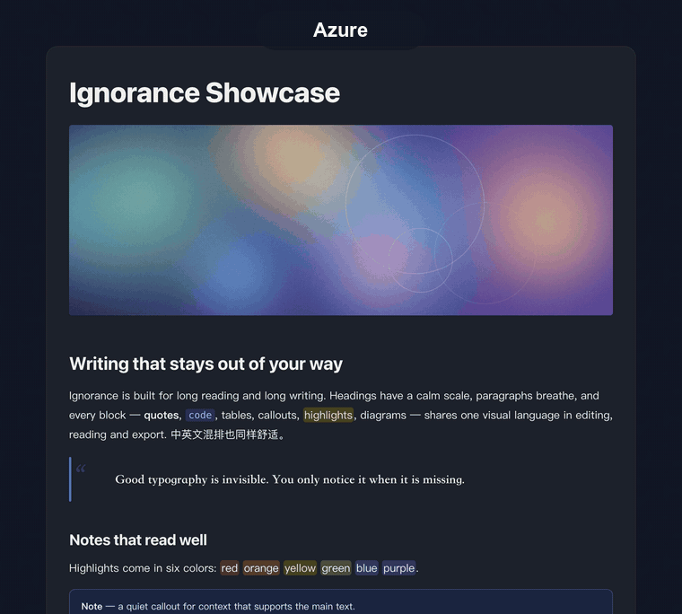
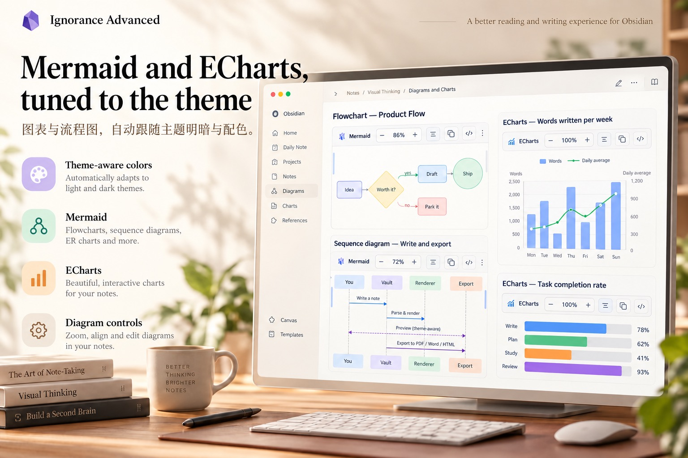
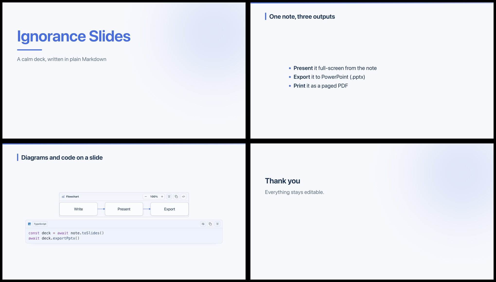
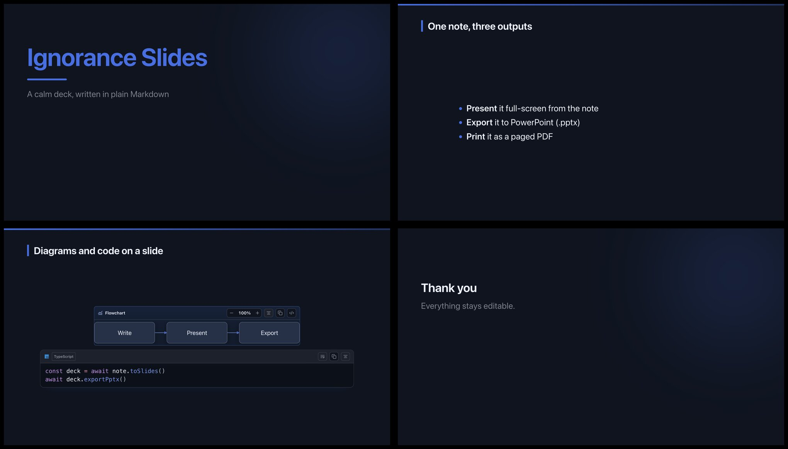
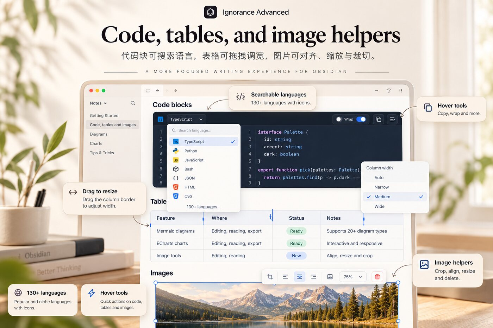
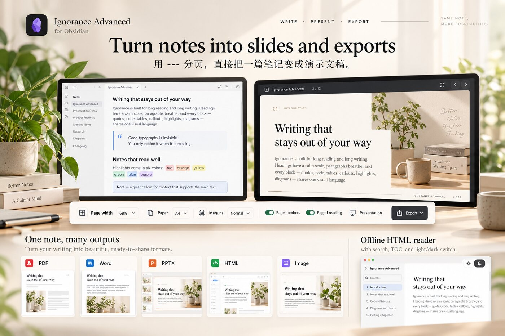
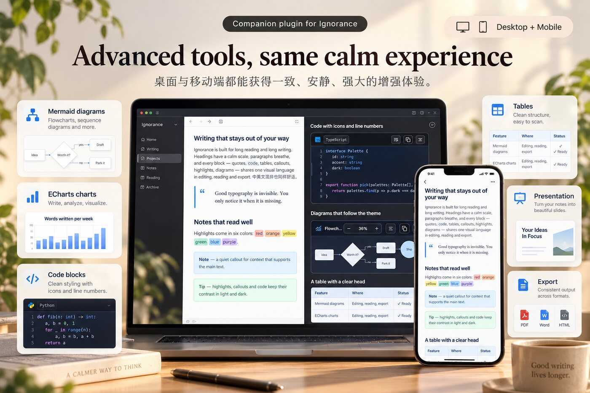
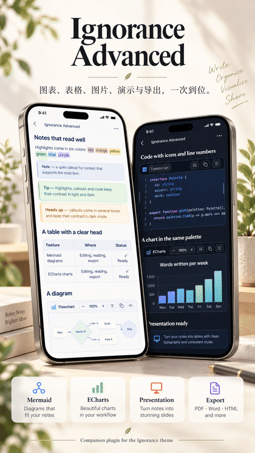

<div align="center">

# Ignorance Advanced

**The companion plugin for the [Ignorance theme](https://community.obsidian.md/themes/ignorance):** diagrams, tables, images, presentations and exports in one place.

[中文](README.zh-CN.md) · [Support](#support)




</div>

> The theme owns the look; the plugin adds what CSS cannot do. It works with other themes too, but its controls are designed around the theme's tokens and look plainer without it.

## Palettes: eight, one click

Choose Azure, Pine, Book, Graphite, Terracotta, Teal, Wisteria or Amber in the plugin settings, each tuned for light and dark.

<div align="center">
 
</div>

## Features

### Mermaid enhancement
Obsidian's built-in Mermaid, recolored to the active theme and palette in light and dark. Each diagram has zoom, copy / edit source, left / center / right placement and drag-to-resize width (saved on the fence as `{align=center} {width=560}`).

### ECharts enhancement
Apache ECharts blocks render in place, follow the theme palette, and share the same controls as Mermaid.

<div align="center">

</div>

### Table enhancement
Drag column and row edges with detents (fit-to-content or equal share; Alt drags freely, Shift steps by 10 px). A size menu fits all columns, equalizes, fills the text width or resets; double-click an edge to fit it; left / center / right placement. Buttons appear on hover and work on mobile.

### Presentations (PPT)
Turn any note into a deck with `---` between slides: full-screen presenting, diagrams and code blocks carried onto the slide as-is, **PPTX export**, or a paged PDF. The note stays plain Markdown and editable.

<div align="center">
 
</div>

### Code blocks
A searchable language picker (type `py`, `ts`, `sql`), 130+ languages, language icons, line numbers, copy, soft wrap. The file explorer gets Material Icon Theme file icons, with distinct open, closed and empty folders.

### Images
Align, resize with eight handles, copy, remove, and **crop** (then replace the original or add a new image).

<div align="center">

</div>

### Reading and export
A page toolbar (content width, paper size, margins, page numbers, a paged view that matches PDF output). Export to PDF, Word, PowerPoint, images, and a standalone offline HTML reader with table of contents, search and a light/dark switch. Choose Microsoft YaHei, theme fonts or SimSun for Word in settings. HTML readers keep theme and width in the URL fragment across reloads without browser storage.

<div align="center">

</div>

### And more
Tab reuse, typewriter and focus modes, smart punctuation, `==🟢colored==` highlights, web clipping, and Markdown import from Word, PDF, Excel, PowerPoint and more (desktop).

## Desktop and mobile

<div align="center">

<br><br>

</div>

## Install

- **Community plugins**: Settings → Community plugins → Browse → search "Ignorance Advanced". ([plugin page](https://community.obsidian.md/plugins/ignorance-advanced))
- **Manual**: download `main.js`, `manifest.json` and `styles.css` from the [latest release](https://github.com/ignorance-shiyao/obsidian-ignorance-advanced/releases/latest) into `<vault>/.obsidian/plugins/ignorance-advanced/`, then enable it.
- **Theme**: install [Ignorance](https://community.obsidian.md/themes/ignorance) from Settings → Appearance for the full look.

Requires Obsidian 1.8.7 or later. Works on desktop and mobile; Word/PDF import and some exports need the desktop app.

## Usage

- **Diagrams and charts**: write a fenced block with the language `mermaid` or `echarts`. It renders in Live Preview and Reading view; hover it for zoom, copy, edit-source and alignment controls, and drag its edges to resize.
- **Tables**: drag a column or row edge to resize; Alt drags freely, Shift steps by 10 px, double-click an edge to fit it.
- **Images**: click an image to align, resize or crop it.
- **Code blocks**: click the language label to search the language list; line numbers and soft wrap are in the block toolbar.
- **Presentations**: separate slides with a line containing `---`, then use the *Presentation* button in the page toolbar at the top of the note (or run *Open presentation mode* from the command palette).
- **Presenting aids**: the presentation toolbar and the fullscreen bar have a laser pointer (a red dot that follows the mouse) and a spotlight (only the area around the mouse stays bright); click again to turn off. "Step by step" shows the next block of a slide before moving to the next slide, and "Quiet view" hides the toolbar until the mouse reaches the top.
- **Inline components**: `((green:build | passed))` two-part badge, `((spoiler:answer))` click to reveal, `((ruby:汉字 | hànzì))` ruby annotation, `((crumb:Settings > Appearance > Themes))` breadcrumb, plus `((bar:72:progress))` and `((spark:3,5,2))`.
- **Image compare**: put two images inside `::: compare`; drag the divider in Reading view, and exports show them side by side.
- **Click-to-play GIFs**: write `click` in a GIF's alt text (``); it shows its first frame with a play badge, plays on click and stops on the next click; exports keep the still frame.
- **Image filters**: write `gray`, `sepia`, `invert`, `dark-invert` (inverts only in dark mode) or `blur` (clears on hover) in the image's alt text, for example ``.
- **Tabs**: wrap `::: tab Title` blocks in `::: tabs`; click a title in Reading view to switch, and print or export lays every panel out in order.
- **Table extras**: a cell holding only `<` joins the cell on its left, only `^` joins the cell above, and `[ ]` / `[x]` show as boxes. In a right-aligned column (`---:`) integers of five or more digits get thousands separators and `72%` draws a bar; a row whose first cell starts with `>` becomes a child of the row above, which gets a fold button; tables over 16 rows scroll inside their own frame with a frozen header in Reading view.
- **Captions and cross references**: turn on "Figure and table captions" in settings, or add `ib-captions` to a note's `cssclasses`. An image alone on a line, ``, shows as "Figure 1 Architecture"; a line `Table: Quarterly revenue {#tab-q}` under a table shows as "Table 1 …"; `Listing: …` under a code block and `Equation: …` under a `$$` equation are numbered the same way; refer to either with `((ref:fig-arch))`, which links to it.
- **Card layout**: add `ib-cards` to a note's `cssclasses` and every H2 section is drawn as a card in Reading view.
- **Table crosshair**: turn it on in settings, or add `ib-crosshair` to a note's `cssclasses`, and pointing at a cell in Reading view lights up its row and column.
- **Long code blocks folded**: with the setting on, code blocks over 40 lines show only their start in Reading view with a "Show all" button; paged reading and exports always keep them whole.
- **Unpublished content**: strike a whole heading through (`## ~~Draft~~`) and that section, sub-sections included, is dimmed and marked in Reading view, left out of paged reading and exports, and does not take a number.
- **Heading numbers**: turn on "Heading numbers" in settings, or add `ib-numbered` to a note's `cssclasses`, to show 1, 1.1, 1.1.1 before headings in Reading view and Live Preview; a setting switches to a Chinese 一、（一） style.
- **Navigation**: the "Jump to a heading, figure, table or code block" command lists headings, images, tables, code blocks and diagrams of the current note; type to filter, Enter to jump.
- **Navigation sidebar**: the "Open navigation in the sidebar" command keeps the same list open on the right; it follows the current note, filters as you type, and jumps on click.
- **Link check**: run "Check links and headings in the current note" from the command palette to list missing notes, missing embeds, broken heading links and duplicate headings; click a row to jump there.
- **Batch clipping**: the "Clip web pages in bulk" command takes many links at once and skips ones already clipped; "Sort by site" in settings files clippings into one sub-folder per website.
- **Gray mode**: list dates in settings (for example `4-4`) and the whole interface turns grayscale on those days; off by default.
- **Reading time**: on desktop the status bar shows the estimated reading time of the current note; turn it off in settings.
- **Cover**: add `ib-cover` to a note's `cssclasses` and Reading view opens with a cover built from the properties (`title`, `subtitle` or `description`, `author`, `date` or `created`, `tags`); the inline title is hidden.
- **Page footer**: "Footer" in the page settings menu puts text at the bottom left of every page in the paged view and in exports, with `{title}`, `{page}`, `{pages}` and `{date}`.
- **Layout presets**: "Layout presets" in the page settings menu fills in paper, margins and page numbers for a paper, a report, an official document or a blog post; every value can still be changed afterwards.
- **Start page and feature gallery** (next release): *Open start page* lists four jobs (weekly report, presentation, Word delivery, tidy clippings) with a ready example for each; *Create feature gallery page* writes one copyable sample note for the theme and the plugin.
- **Export support table** (next release): *Show export support table* lists what each export format keeps of each kind of block; the check at the top of an export preview points at the exact lines in the current note.
- **Your own templates** (next release): put Markdown templates in the folder set under *Templates and language*, then run *New note from template*; `{{title}}`, `{{author}}`, `{{date}}` and `{{time}}` are filled in, and `ib-layout: layout name` in the properties applies a saved layout. *Export template pack* and *Import template pack* move templates and layouts between vaults.
- **Scripting** (next release): `app.plugins.plugins["ignorance-advanced"].api` offers `exportNote`, `createNote`, `checkNote`, `listLayouts` and `listTemplates` for QuickAdd, Templater or your own scripts. Calls name the note, layout and format explicitly, never open a dialog, and return `{ ok, ... , warnings }` instead of throwing.
- **Interface language** (next release): *Interface language* in settings follows Obsidian or is set to Chinese or English. Command names, the toolbar, dialogs, notices, settings and the exported HTML reader are translated; inserted templates come with English sample text, and cover and document labels follow the language. File and folder names stay as they are.
- **Layouts across devices** (next release): saved layouts carry an update time and deletion marks, so layouts changed on two devices are merged rather than one overwriting the other.
- **Export**: use the export button in the page toolbar to produce PDF, Word, PowerPoint, images or an offline HTML reader.
- **Settings**: Settings → Ignorance Advanced (palette, page layout, highlight colors, tab behavior).

## Privacy and network use

- No telemetry, no analytics, no ads.
- Nothing is downloaded or updated by the plugin itself. Mermaid, PDF.js and the HTML converter are Obsidian's own; the other libraries (ECharts, the export engines…) are bundled in `main.js` (about 3.6 MB) and start only when a feature needs them.
- Network requests happen only when you ask for them: fetching a web page you clip, an image URL you export or copy, or a cover image URL you set in a note.
- **Only the vault:** the plugin reads and writes through Obsidian's vault API and never touches the file system, other programs or Electron directly. Exports are saved into the vault's `导出/` folder; on desktop, PDF goes through the system print dialog (choose "Save as PDF"). Everything works the same on desktop and mobile.

## Build from source

```bash
npm install
npm run build          # writes dist/main.js, dist/styles.css, dist/manifest.json
npm test
OBSIDIAN_VAULT=/path/to/vault npm run install:vault   # build and copy into a vault
```

## Feedback

If you run into a problem or want a feature, please [open an issue](https://github.com/ignorance-shiyao/obsidian-ignorance-advanced/issues). A screenshot, your Obsidian version and the platform (desktop or mobile) help a lot.

## Support

If this is useful to you, you can buy me a coffee. Thank you!

| WeChat | Alipay |
| --- | --- |
|  |  |

## License

[MIT](LICENSE). Third-party software is listed in [THIRD_PARTY_NOTICES.md](THIRD_PARTY_NOTICES.md); license texts are in [`licenses/`](licenses).
